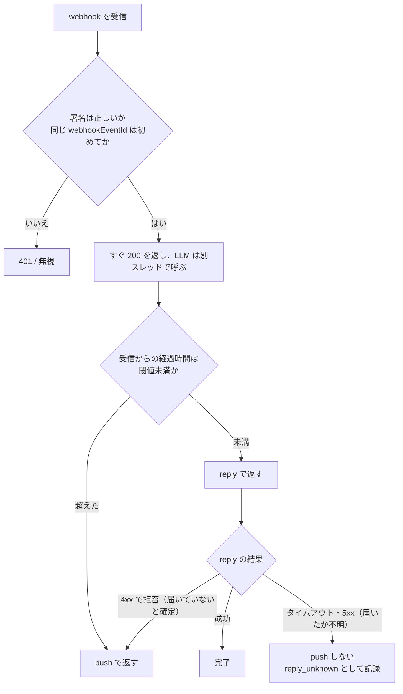

:::message
この記事は、Claude Codeを執筆支援に使った "週1本書く" 取り組みの一環で書いています。

- 目的: 自分のAI活用キャッチアップ。仕組み自体も毎月アップデートしていきます
- 体制: 題材選定・実装・下書きをClaude Codeで補助し、動作確認と編集を経て人が公開を判断
- 方針: Zennのガイドラインに真摯に向き合い、運営から指摘や警告があれば即座に取り組みを停止します

仕組みの全貌は[こちらの設計記事](https://zenn.dev/liatris/articles/20260701-zenn-kickoff)にまとめています。
:::

LLM を挟んだ LINE ボットは、応答が遅れた回だけ `400: Invalid reply token.` で返信が落ちる。原因は reply token の寿命に間に合わないことで、LLM の応答時間が伸びるほど起きやすくなる。

寿命は公式ドキュメントでは明確な秒数が見つけにくく、情報源によって 30 秒前後とも約 60 秒とも書かれている。そこで秒数を決め打ちせず、受信からの経過時間を測って reply と push を切り替える作りにした。



## 失敗パターンは2つあって、文言が同じ

reply token は 1 回限りで短命。失敗は次の 2 通りで、どちらも `Invalid reply token.` で返ってくるので、ログだけでは区別しにくい。

- 期限切れ: LLM が遅くて間に合わなかった
- 二重使用: LINE の webhook 再送を二重に処理して、同じ token を 2 回使った

前者は経過時間で、後者は `webhookEventId` で防げる。原因が別なので対策も分けた。

## 設計

1. webhook は署名検証だけして即 200 を返す。LLM 呼び出しは別スレッドへ逃がす
2. 受信時刻を `time.monotonic()` で記録しておく
3. 返信の直前に経過時間を見て、閾値未満なら reply、超えていたら push
4. reply が拒否されたら push にフォールバックする。ただし送れたか分からない失敗では push しない。どの経路で返したかはログに残す

push は課金対象なので、できるだけ reply で返したい。一方、閾値を攻めすぎると送信直前に token が切れる。このトレードオフを `REPLY_THRESHOLD_SEC` の 1 つに寄せた。

## 実装

外部ライブラリなしの Python 3 で書いた。ここでは中心になる切り替え部分だけ載せる。前提は次のとおり。

- 署名検証（`X-Line-Signature` の HMAC-SHA256）と `webhookEventId` の重複排除は、成果物リポジトリの `router.py` にある
- `client` は `reply` と `push` を持つオブジェクトで、LINE が reply を 4xx で拒否したときは `ReplyRejected` を投げる
- `clock` を差し替えられるので、実際に待たなくてもテストできる

```python
class ReplyRejected(Exception):
    """LINE が reply を 4xx で拒否した (期限切れ・使用済みなど)。未配信が確定している。"""


class ReplyRouter:
    """受信時刻からの経過秒が threshold_sec 未満なら reply、以上なら push。"""

    def __init__(self, client, threshold_sec: float = 20.0, clock=time.monotonic, log=print):
        self.client = client
        self.threshold_sec = threshold_sec
        self.clock = clock
        self.log = log
        self.counts = {"reply": 0, "push": 0, "reply_failed_then_push": 0, "reply_unknown": 0}

    def respond(self, received_at: float, reply_token: str, user_id: str, text: str) -> str:
        elapsed = self.clock() - received_at
        if elapsed < self.threshold_sec:
            try:
                self.client.reply(reply_token, text)
                return self._done("reply", elapsed)
            except ReplyRejected as e:  # 未配信が確定。token は二度と使えないので push へ
                self.log(f"reply rejected after {elapsed:.1f}s: {e}")
                self.client.push(user_id, text)
                return self._done("reply_failed_then_push", elapsed)
            except Exception as e:  # タイムアウト・5xx 等。届いた可能性があるので push しない
                self.log(f"reply result unknown after {elapsed:.1f}s: {e}")
                return self._done("reply_unknown", elapsed)
        self.client.push(user_id, text)
        return self._done("push", elapsed)

    def _done(self, route: str, elapsed: float) -> str:
        self.counts[route] += 1
        self.log(f"route={route} elapsed={elapsed:.1f}s")
        return route
```

ハマったのは、reply が失敗したときの扱い。最初は例外をログに出して終わりにしていたが、それではユーザーに何も届かない。token は一度失敗したら二度と使えないので、再試行ではなく push に回すことにした。

ただし、どの例外でも push に回すと別の事故が起きる。LINE の[リトライに関するドキュメント](https://developers.line.biz/en/docs/messaging-api/retrying-api-request/)にあるとおり、タイムアウトや 5xx の場合はメッセージが配信済みの可能性がある。そこで push に回すのは 4xx（`400: Invalid reply token.` など、受け付けられなかったことが確定するもの）だけにした。送れたか分からない失敗は `reply_unknown` として記録し、push はしない。二重に届くより、取りこぼしを件数で見張るほうを選んだ。

## 動作確認

`clock` を固定した偽クライアントで、経路ごとの挙動をテストした。

- 受信から 5 秒後 → reply
- 受信から 30 秒後 → push
- reply が `400: Invalid reply token.` で拒否された → push にフォールバック
- reply がタイムアウトした（届いたか不明）→ push しない
- 同じ `webhookEventId` の 2 回目 → 無視
- 署名が不正 → 401

6 本とも通る。ただし**これは分岐ロジックの確認で、LINE 側の実際の寿命は測っていない**。閾値の既定値 20 秒は実測から出した数字ではなく、情報源の下限（30 秒前後）に余裕を持たせた仮置き。実チャネルでの計測が済むまで、記事内で寿命の秒数は断定しない。

## 閾値をどう決めるか

閾値を固定値で持つか、失敗率から決めるかは、返信経路別の件数を取れば判断できる。ログには経路を 4 種類出している。

| ログの経路 | 意味 | 件数が多いときの読み方 |
|---|---|---|
| `route=reply` | 期限内に reply で返せた | — |
| `route=push` | 閾値を超えたので push で返した | push ばかりなら課金が無駄 |
| `route=reply_failed_then_push` | reply が拒否され、push に回した | 0 でなければ閾値が攻めすぎ |
| `route=reply_unknown` | reply が届いたか分からない | 閾値ではなく通信側を疑う |

まず件数を集計してから閾値を動かす順番にしたい。

コードは次のリポジトリにある。

@[github](https://github.com/liatris000/liatris-20261119-line-bot-reply-token-budget)

reply token の寿命の秒数が分からないままでも、返し方は決められる。秒数を決め打ちせず経過時間で reply と push を切り替え、push に回すのは拒否が確定した 4xx だけにする。届いたか分からない失敗は push せず、件数で見張る。
