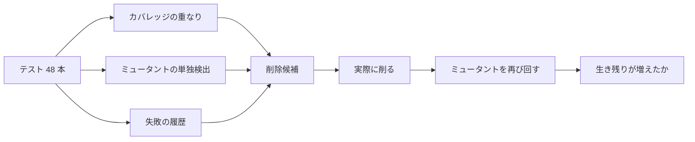

:::message
この記事は、Claude Codeを執筆支援に使った "週1本書く" 取り組みの一環で書いています。

- 目的: 自分のAI活用キャッチアップ。仕組み自体も毎月アップデートしていきます
- 体制: 題材選定・実装・下書きをClaude Codeで補助し、動作確認と編集を経て人が公開を判断
- 方針: Zennのガイドラインに真摯に向き合い、運営から指摘や警告があれば即座に取り組みを停止します

仕組みの全貌は[こちらの設計記事](https://zenn.dev/liatris/articles/20260701-zenn-kickoff)にまとめています。
:::

テストが増えるほど CI は遅くなり、どれを消してよいかを誰も説明できなくなる。「重複していそう」という勘で消すと、最後の 1 本だった検査まで一緒に消える。

そこで、削除候補を出す 3 つの基準を同じテストスイートに当て、実際に削ってから検出力が落ちたかを測った。



## 比べる 3 つの基準

どの基準も、「削っても検出力が落ちない」ことそのものではなく、その代わりになる何かを測っている。

| 基準 | 削ってよいとみなす条件 | 代わりに測っているもの |
|---|---|---|
| カバレッジの重なり | 通る行を、残りの別のテストも通る | 実行されたこと |
| ミュータントの単独検出 | 殺すミュータントを、残りの別のテストも殺す | 壊れたコードを見つけたこと |
| 失敗の履歴 | 履歴の中で一度も落ちていない | 過去に役に立ったこと |

## 検証の手順

対象は 60 行ほどの料金計算(`shop/pricing.py`)と、そのテスト 48 本。同じ入力を別名で確かめる重複を 5 組、何も確かめずに関数を呼ぶだけのテストを 5 本混ぜた。

ミューテーションテストは自作した。どのテストがミュータントを殺したかをテスト単位で取り出したかったので、pytest を 1 回回して落ちたテストの nodeid を全部記録している。

ミュータントは 2 つに分けた。グループ A(比較・算術演算子の置き換え、20 個)で削除候補を選び、グループ B(整数定数・and/or・not・return の書き換え、41 個)で答え合わせする。A だけで選んで A で測ると、選んだ基準が有利になるだけだからだ。

失敗の履歴は、実際の CI ログが無いので、起きそうなバグを手で 6 件書いて作った。履歴で一度も落ちなかったテストは全部削る。カバレッジとミュータントの基準は、テストを並び順に見て、担う項目(行・ミュータント)を残りの別のテストがすべて担っていれば削る、という貪欲法にした。

```python
def _greedy(tests, items_of, owners_of, protected=frozenset()):
    remaining = set(tests)
    deleted = []
    for test in tests:
        if test in protected:
            continue
        covered_elsewhere = all((owners_of(item) & remaining) - {test} for item in items_of(test))
        if covered_elsewhere:
            remaining.discard(test)
            deleted.append(test)
    return deleted
```

## 結果

全テストでは、A は 20 個すべて、B は 40 個のミュータントを殺せた。基準ごとに削って回し直した結果は次のとおり。

| 基準 | 削った本数 | 残り | 低下 A | 低下 B |
|---|---|---|---|---|
| カバレッジの重なり | 39 | 9 | 8 | 11 |
| ミュータントの単独検出 | 38 | 10 | 0 | 7 |
| 失敗の履歴 | 33 | 15 | 9 | 18 |

3 つとも 48 本のうち 33〜39 本を削る候補を出し、B の検出力はどれも落ちた。ミュータントの単独検出は A で 0 だが、A で選んで A で測っているので当然だ。B では 7 個を取りこぼした。たとえば `PCT31` を拒否するテストは、同じ行の A のミュータントを別のテストも殺していたので削られ、上限の定数を書き換える B の `30 -> 31` は誰も殺せなくなった。

カバレッジの重なりは、何も確かめない `test_order_total_smoke` を残し、送料無料の 5000 円ちょうどを確かめるテストを 3 本とも削った。そのため B の `5000 -> 5001` は誰も殺せなくなった。行は通っていても、値は見ていない。

失敗の履歴は B で 18 個と最も多く落とした。履歴が手書きの 6 件で、そこに無い種類のバグには何も言えないためだ。実際の CI ログなら結果は変わりうる。

## 削る前に残す線を決める

テストの外し方でも結果が変わる。`--deselect` で外すと、ミュータント基準の A が 0 でなく 3 になった。`--deselect` は前方一致で、`test_percent_coupon` を外すと `test_percent_coupon_upper_bound` まで外れる。残すテストを引数で渡す方式にすると 0 になった。

そのうえで、守るべき規則ごとに残すテストを人が決めた。数量は 1〜99、まとめ買い割引は 5・10・50 本から、送料無料は 5000 円ちょうどから、など 7 つの規則で 14 本。これを機械の候補から除くと、結果は変わった。

| 基準 + 残す線 | 削った本数 | 残り | 低下 A | 低下 B |
|---|---|---|---|---|
| カバレッジの重なり | 31 | 17 | 1 | 4 |
| ミュータントの単独検出 | 31 | 17 | 0 | 2 |
| 失敗の履歴 | 24 | 24 | 1 | 4 |

B の取りこぼしは、最悪の 18 個から 2〜4 個に減った。ミュータント基準の 2 個は、空のクーポン文字列を「クーポン無し」として扱うことと、数量に `True` を渡したら拒否することだった。どちらも残す線に載せていなかった規則だ。

@[github](https://github.com/liatris000/liatris-20261126-test-pruning-criteria)

削除の判断には、ミュータントの単独検出と、人が決めた残す線を組み合わせて使うのがよい。カバレッジの重なりと失敗の履歴は、候補を挙げる補助に留める。このサンプルでは、機械の基準だけで削ると 7〜18 個を落とし、残す線を足すと 2〜4 個に収まった。
