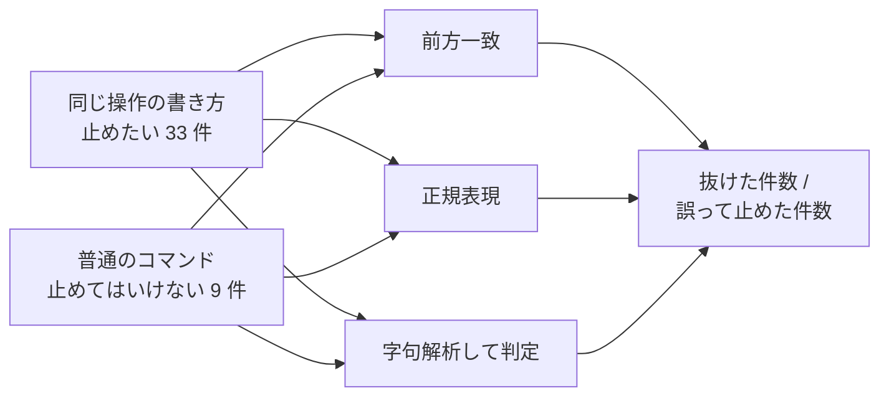

:::message
この記事は、Claude Codeを執筆支援に使った "週1本書く" 取り組みの一環で書いています。

- 目的: 自分のAI活用キャッチアップ。仕組み自体も毎月アップデートしていきます
- 体制: 題材選定・実装・下書きをClaude Codeで補助し、動作確認と編集を経て人が公開を判断
- 方針: Zennのガイドラインに真摯に向き合い、運営から指摘や警告があれば即座に取り組みを停止します

仕組みの全貌は[こちらの設計記事](https://zenn.dev/liatris/articles/20260701-zenn-kickoff)にまとめています。
:::

`git commit` を止める hook を置いても、`git -C /repo commit` と書けば通ってしまいます。git がサブコマンドの前にオプションを置けるからです。

この迂回は、公開 Issue で何度も報告されています。

- [#13371](https://github.com/anthropics/claude-code/issues/13371)
- [#18613](https://github.com/anthropics/claude-code/issues/18613)

そこで、同じ操作を書き方だけ変えて 33 通り並べ、文字列を見るガード 2 方式と、構文を解析してから判定する方式に流して、何件抜けるかを数えました。



## 同じ操作を、書き方を変えて並べる

止めたい操作は、git のコミット、git の強制 push、`rm` の再帰削除の 3 つに絞りました。それぞれに、意味は同じで書き方だけ違う形を並べます。

| 書き方の種類 | 例 |
|---|---|
| 空白・フラグの順序や分割 | `rm -f -r /tmp/work` |
| 絶対パス・環境変数・ラッパー | `GIT_AUTHOR_NAME=x git commit -m wip` |
| 複合コマンド・シェル経由 | `sh -c 'cd /repo && git commit -m wip'` |
| git のグローバルオプション | `git --no-pager commit -m wip` |
| 引用符で割る・refspec・フラグ結合 | `git c''ommit -m wip` |
| 実行時に決まる | `g=git; $g commit -m wip` |
| 別のコマンドで同じ操作 | `find /tmp/work -delete` |

止める側だけを数えると、何でも止めるガードが一番良く見えてしまいます。そこで、止めてはいけない普通のコマンドも 9 件混ぜました。引数に危険な文字列を含むものや、名前が似ているものです。

```bash
git log --grep="git commit"
git commit-graph write
```

## 比べる 3 つのガード

どれも、止めるなら理由を、通すなら `None` を返す関数にしました。

- 前方一致: コマンド全体が `git commit` や `rm -rf` で始まるかだけを見る。権限ルールの前方一致と同じ考え方ですが、Claude Code の実際の照合とは別物の自作です
- 正規表現: `\bgit\s+commit\b` のようなパターンを文字列全体から探す。hook でよく見る書き方です
- 字句解析: 次の手順で判定する

1. `shlex` で単語に分ける
2. `;` や `&&`、改行などの区切りで複合コマンドを分ける
3. 環境変数の前置きと `env` `command` などのラッパーを剥がす
4. `bash -c` と `eval` に渡した文字列、コマンド置換の中身は再帰で調べる
5. git はグローバルオプションを飛ばしてからサブコマンドを見る

解析の部分を、`guards.py` から短くまとめた版です。これだけで動き、テストケースに流すと同じ件数になります。

```python
import os
import re
import shlex

SEPARATORS = {";", "&", "&&", "|", "||", "|&", "(", ")", "\n", ";;"}
SHELLS = {"bash", "sh", "zsh", "dash", "ksh"}
WRAPPERS = {"env": {"-u", "-C"}, "sudo": {"-u", "-g"}, "command": set(), "exec": {"-a"},
            "nohup": set(), "nice": {"-n"}, "time": set(), "xargs": {"-I", "-n", "-P"}}
GIT_OPTS_WITH_VALUE = {"-C", "-c", "--git-dir", "--work-tree", "--namespace", "--exec-path", "--config-env"}
ASSIGNMENT = re.compile(r"^[A-Za-z_][A-Za-z0-9_]*=")
SUBSTITUTION = re.compile(r"\$\(([^()]*)\)|`([^`]*)`")


def tokenize(command):
    lexer = shlex.shlex(command, posix=True, punctuation_chars=";&|()\n")
    lexer.whitespace = " \t\r"  # 改行はコマンドの区切りとして残す
    lexer.whitespace_split = True
    lexer.commenters = ""
    return list(lexer)


def split_segments(tokens):
    segments, current = [], []
    for tok in tokens:
        if tok in SEPARATORS:
            if current:
                segments.append(current)
            current = []
        else:
            current.append(tok)
    if current:
        segments.append(current)
    return segments


def unwrap(argv):
    i = 0
    while i < len(argv):
        name = os.path.basename(argv[i])
        if ASSIGNMENT.match(argv[i]):
            i += 1
        elif name in WRAPPERS:
            i += 1
            while i < len(argv) and argv[i].startswith("-"):
                i += 2 if argv[i] in WRAPPERS[name] else 1
        else:
            break
    rest = argv[i:]
    return [os.path.basename(rest[0])] + rest[1:] if rest else []


def short_flag(arg, letters):
    return re.fullmatch(r"-[a-zA-Z]+", arg) and any(c in arg for c in letters)


def check_git(args):
    i = 0
    while i < len(args) and args[i].startswith("-"):
        i += 2 if args[i] in GIT_OPTS_WITH_VALUE else 1
    if i >= len(args):
        return None
    sub, rest = args[i], args[i + 1:]
    if sub == "commit":
        return "git commit"
    if sub == "push":
        if any(a == "--force" or short_flag(a, "f") for a in rest):
            return "git push --force"
        positional = [a for a in rest if not a.startswith("-")]
        if any(p.startswith("+") for p in positional[1:]):
            return "git push +refspec"
    return None


def check(command, depth=0):
    if depth > 5:
        return "入れ子が深すぎる"
    for m in SUBSTITUTION.finditer(command):
        reason = check(m.group(1) or m.group(2) or "", depth + 1)
        if reason:
            return reason
    try:
        tokens = tokenize(command)
    except ValueError as e:
        return f"解析できない ({e})"
    for segment in split_segments(tokens):
        argv = unwrap(segment)
        if not argv:
            continue
        name, args = argv[0], argv[1:]
        reason = None
        if name in SHELLS and "-c" in args and args.index("-c") + 1 < len(args):
            reason = check(args[args.index("-c") + 1], depth + 1)
        elif name == "eval":
            reason = check(" ".join(args), depth + 1)
        elif name == "git":
            reason = check_git(args)
        elif name == "rm" and any(a == "--recursive" or short_flag(a, "rR") for a in args):
            reason = "rm -r"
        if reason:
            return reason
    return None


if __name__ == "__main__":
    for c in ["git -C /repo commit -m x", "cd /r && bash -c 'rm -fr x'", 'git log --grep="git commit"']:
        print(c, "->", check(c))
```

判定できない入力の扱いは、2 か所で止める側に倒しました。引用符が閉じていない入力は解析できない理由を返して止めます。また、`#` はコメントとして扱いません。`echo "#tag"; git commit` で `#` 以降を捨てると、後ろのコミットを見落とすからです。

hook にするときは、標準入力の JSON から `tool_input.command` を取り出して `check` に渡します。止めるなら理由を標準エラーに出し、終了コード 2 で終えます。設定例とあわせて成果物のリポジトリに置きました。

<!-- ARTIFACT_LINKS -->

## 結果

止めたい 33 件のうち、各方式が止めた件数を書き方の種類ごとに並べます。

| 書き方の種類 | 件数 | 前方一致 | 正規表現 | 字句解析 |
|---|---|---|---|---|
| 基本形 | 5 | 5 | 5 | 5 |
| 空白・フラグの順序や分割・長いオプション | 4 | 0 | 4 | 4 |
| 絶対パス・環境変数・ラッパー | 4 | 0 | 4 | 4 |
| 複合コマンド・シェル経由 | 7 | 0 | 7 | 7 |
| git のグローバルオプション | 4 | 0 | 0 | 4 |
| 引用符で割る・+refspec・フラグ結合 | 3 | 0 | 0 | 3 |
| 実行時に決まる | 4 | 0 | 1 | 0 |
| 別のコマンドで同じ操作 | 2 | 0 | 0 | 0 |
| **抜けた件数** | | **28** | **12** | **6** |
| **誤って止めた件数(9 件中)** | | 0 | 5 | 0 |

前方一致が止めたのは、登録した文字列そのままの 5 件だけでした。空白を 2 つにした `git  commit` でも抜けます。

正規表現は抜けを 12 件まで減らしましたが、普通のコマンドを 9 件中 5 件止めました。原因は 3 つです。

| 誤って止めたコマンド | 原因 |
|---|---|
| `git log --grep="git commit"` ほか 2 件 | 引数の中の文字列に反応した |
| `git commit-graph write` | `\b` が `-` の前でも成り立つ |
| `git push origin main && rm -f /tmp/out.log` | `.*` が `&&` を越えて `rm` の `-f` を拾った |

これだけ誤って止めると、普段の作業が何度も止まります。

字句解析は、正規表現が抜けた git のグローバルオプション 4 件と、引用符などの 3 件を止めました。誤って止めた件数は 0 です。ただ、普通のコマンドは 9 件しか用意していないので、0 件は「この 9 件では起きなかった」という意味にとどまります。

1 件だけ、正規表現が止めて字句解析が抜けた書き方があります。`echo 'git commit -m wip' | bash` です。

字句解析は、`echo` の引数をただの文字列として扱います。止めてはいけない側の `echo "git commit を止める hook"` を通すには、これが正しい扱いです。同じ文字列でも、パイプの先がシェルかどうかで実行されるかが変わります。正規表現が止めたのは、意味を分かったからではなく、文字列がたまたま見えていたからです。

## どこまで解析すれば足りるか

字句解析でも抜けた 6 件は、どれも実行するコマンドが文字列に書かれていません。

| 書き方 | 実際のコマンドが決まる場所 |
|---|---|
| `g=git; $g commit` | 変数の値(実行時) |
| `git -c alias.ci=commit ci` | git の設定(エイリアスはユーザーの設定ファイルにも書ける) |
| `echo '...' \| bash` | 標準入力の中身 |
| `bash ./commit.sh` | ファイルの中身 |
| `find -delete` / `shutil.rmtree` | 別のプログラム |

解析を深くすれば、このうち変数やエイリアスのいくつかは追えます。ただ、ファイルの中身や別のプログラムが何をするかは、コマンドの文字列からは分かりません。`rm` を止めても、同じ削除ができるコマンドはほかにいくらでもあります。

測った結果から、置き方を次のように決めました。

- hook は字句解析の方式にする。正規表現は 9 件中 5 件を誤って止めるので、普段の作業を妨げる
- 前方一致は、許可するルールには使えても、止めるルールとしては基本形しか止められない
- 残る 6 件の形は、コマンドを見て止めるのをやめ、実行する側で止める。強制 push はリモートのブランチ保護で止める。削除は、作業ディレクトリの外に書けない環境で動かす

コマンドの文字列を見るガードが止められるのは、文字列に実行するコマンドがそのまま書かれている形までです。そこから先は、解析を深くしても追いつかないので、実行する側の権限で止めます。
