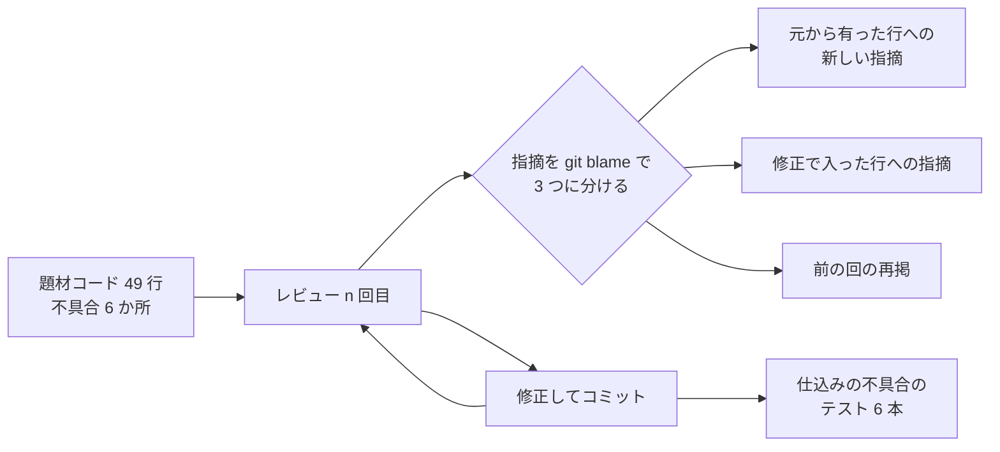

:::message
この記事は、Claude Codeを執筆支援に使った "週1本書く" 取り組みの一環で書いています。

- 目的: 自分のAI活用キャッチアップ。仕組み自体も毎月アップデートしていきます
- 体制: 題材選定・実装・下書きをClaude Codeで補助し、動作確認と編集を経て人が公開を判断
- 方針: Zennのガイドラインに真摯に向き合い、運営から指摘や警告があれば即座に取り組みを停止します

仕組みの全貌は[こちらの設計記事](https://zenn.dev/liatris/articles/20260701-zenn-kickoff)にまとめています。
:::

AI のレビュー指摘を直して push すると、前の差分にも有ったコードに新しい指摘が付く。この報告は [GitHub Community #189767](https://github.com/orgs/community/discussions/189767)、[Cursor Forum](https://forum.cursor.com/t/bugbot-doesnt-catch-all-issues-on-first-pass-multiple-review-cycles-needed/151367)、[claude-code #61989](https://github.com/anthropics/claude-code/issues/61989) と、別々の場で続いている。

止め時を決めるには、新しい指摘がどこから来ているかを知る必要がある。元のコードの見落としなのか、修正が持ち込んだものなのか、同じ話の言い直しなのか。そこで不具合を 6 か所仕込んだ 49 行の Python モジュールを用意した。`claude -p` でレビューと修正を繰り返し、指摘を出どころで 3 つに分けて数えた。



## 題材コードと、レビューの回し方

題材の `subject/orders.py` には、次の 6 つを仕込んだ。負の数量を通す、割引率を 10 で割る、1 始まりのページで 1 ページ目を飛ばす、既定引数のリストを共有する、例外を握りつぶす、空のリストで 0 除算する。それぞれに pytest のテストを 1 本ずつ用意し、元のコードでは 6 本とも落ちる。

レビュアーと修正役は、どちらも `claude -p` で呼ぶ。ツールは渡さず、コードは行番号付きでプロンプトに埋め込む。レビューには、行番号・重大度・カテゴリ・要旨を JSON 配列で返させる。

```bash
claude -p --output-format json --tools "" --no-session-persistence < prompt.txt
```

1 ラウンドは「レビュー → 修正 → コミット」で、上限は 5 ラウンドにした。Claude Code は 2.1.331、Python は 3.11.18 で回している。

## 指摘を「どこで生まれたか」で 3 つに分ける

修正を毎回 git のコミットにしておくと、指摘の行を `git blame --porcelain` で辿れる。辿った先が最初のコミットなら元から有った行、それ以外なら修正で入った行と分かる。前の回と同じ指摘かどうかは、辿った先が同じコミットの ±3 行以内で、カテゴリも同じかで判定した。

```python
import subprocess


def blame_anchor(repo, path, line):
    """行を、その行を入れたコミットと、そのコミットでの行番号に辿る。"""
    out = subprocess.run(
        ["git", "-C", repo, "blame", "--porcelain", "-L", f"{line},{line}", "HEAD", "--", path],
        capture_output=True, text=True, check=True,
    ).stdout
    sha, orig_line = out.split()[:2]
    return sha, int(orig_line)


def classify(finding, base_sha, prior, window=3):
    """finding / prior の要素は {"origin": sha, "orig_line": int, "category": str}。"""
    for p in prior:
        if (p["origin"] == finding["origin"] and abs(p["orig_line"] - finding["orig_line"]) <= window
                and p["category"] == finding["category"]):
            return "repeat"
    return "original_line" if finding["origin"] == base_sha else "fix_line"
```

この判定には抜けがある。修正で行が書き換わると、同じ趣旨の指摘でも「修正で入った行」に数えてしまう。1 回目に low で出た「`page >= 1` の確認が無い」が、書き換わった行に medium で再び出た例が実際にあった。再掲の数は少なめに出ていると読んでほしい。

## ラウンドごとの内訳

止める条件を「指摘が 0 件」にして、毎回全体をレビューし、指摘を全部直す回し方を 3 回試した。2 回は 2 ラウンド目の指摘が 0 件で止まった。残る 1 回は 5 ラウンドたっても収まらなかった。下の表はその試行 2 の内訳だ。

| ラウンド | 指摘 | 元から有った行・新規 | 修正で入った行 | 再掲 | high / medium / low | 仕込みのテスト |
|---|---|---|---|---|---|---|
| 1 | 10 | 10 | 0 | 0 | 3 / 3 / 4 | 0/6 |
| 2 | 3 | 1 | 2 | 0 | 0 / 0 / 3 | 6/6 |
| 3 | 1 | 1 | 0 | 0 | 0 / 0 / 1 | 6/6 |
| 4 | 2 | 0 | 2 | 0 | 0 / 0 / 2 | 6/6 |
| 5 | 9 | 1 | 7 | 1 | 0 / 1 / 8 | 6/6 |

仕込んだ 6 つは 1 ラウンド目で全部指摘され、1 回目の修正でテストが 6 本とも通った。2〜5 ラウンド目の指摘は延べ 15 件ある。そのうち 11 件が修正で入った行に付き、high は 0 件だった。テストの結果は 1 本も変わっていない。

5 ラウンド目に指摘が増えたのは、4 ラウンド目の low「金額を float で計算している。Decimal を検討」を直したからだ。この修正で `Decimal` への書き換えが入り、5 ラウンド目には NaN や Infinity の扱いなど、書き換えた行への指摘が 7 件付いた。49 行だったコードは、最後に 180 行になった。

## 止め時の条件を比べる

同じ題材で、3 つの回し方を 3 試行ずつ実際に回した。ラウンド上限は、全体レビューの記録を 1 ラウンドで切って求めている。

| 止め時の条件 | 修正の回数 | 終了時のテスト | 指摘の延べ数 | 費用 (USD) |
|---|---|---|---|---|
| 毎回全体をレビューし、全部直す | 1 / 5 / 1 | 6 / 6 / 6 | 9 / 25 / 10 | 0.10 / 0.41 / 0.08 |
| 2 回目以降は前の回の指摘の確認だけ | 1 / 1 / 1 | 6 / 6 / 6 | 9 / 9 / 9 | 0.09 / 0.08 / 0.08 |
| high / medium だけ直す | 3 / 2 / 1 | 6 / **5** / 6 | 20 / 16 / 18 | 0.20 / 0.12 / 0.09 |
| ラウンド上限 1 回 | 1 / 1 / 1 | 6 / 6 / 6 | 9 / 10 / 10 | 0.08 / 0.05 / 0.05 |

重大度で切る条件だけ、仕込んだ不具合を 1 つ残した試行がある。負の数量を通す不具合は、9 試行の 1 ラウンド目のうち 8 回で low と付けられた。high / medium だけ直すと、この不具合は直されずに残る。

試行 2 では最後まで low のままで、テストは 5/6 で終わった。試行 1 では 3 ラウンド目に medium へ上がって直った。重大度のラベルは試行ごとに揺れるので、止める基準には使いにくい。

前の回の指摘の確認だけにする条件は、3 試行とも修正 1 回でテスト 6/6 だった。ただし、これは 1 ラウンド目で仕込みが全部見つかった今回の題材だから言えることだ。1 回目のレビューが見落とした不具合は、この条件では 2 回目以降も見つからない。

<!-- ARTIFACT_LINKS -->

各ラウンドのコードと、レビュー・修正の生の応答は、成果物リポジトリの `logs/` にすべて残している。49 行の 1 ファイルで 3 試行ずつという小さな実験なので、大きな差分で同じ比率になるかは確かめていない。

毎回全体をレビューした 6 試行(全部直す 3 回と、high / medium だけ直す 3 回)を合わせて数えた。2 ラウンド目以降の再掲でない指摘は 29 件だった。そのうち 21 件は修正で入った行に付き、high は 1 件も無かった。

止め時は、指摘の件数や重大度ではなく、指摘が修正で入った行に付いているかで決める。1 回目の指摘を直したら、2 回目以降は前の回の指摘が直ったかだけを確かめ、修正で入った行への新しい指摘は別の作業として切り出す。
