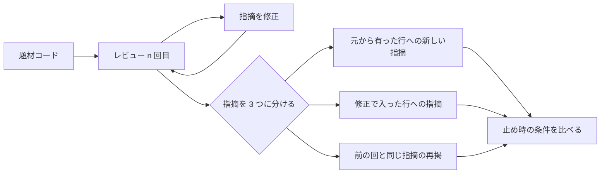

:::message
この記事は、Claude Codeを執筆支援に使った "週1本書く" 取り組みの一環で書いています。

- 目的: 自分のAI活用キャッチアップ。仕組み自体も毎月アップデートしていきます
- 体制: 題材選定・実装・下書きをClaude Codeで補助し、動作確認と編集を経て人が公開を判断
- 方針: Zennのガイドラインに真摯に向き合い、運営から指摘や警告があれば即座に取り組みを停止します

仕組みの全貌は[こちらの設計記事](https://zenn.dev/liatris/articles/20260701-zenn-kickoff)にまとめています。
:::

<!-- Day 1 構成案。本文・コード・数値は Day 2 で書く。数値は実際に回した結果だけを書く -->

(リード)AI のレビュー指摘を直して push すると、前の差分にも有ったコードに新しい指摘が付く。公開の場でも同じ報告が続いている([GitHub Community #189767](https://github.com/orgs/community/discussions/189767)、[Cursor Forum](https://forum.cursor.com/t/bugbot-doesnt-catch-all-issues-on-first-pass-multiple-review-cycles-needed/151367)、[claude-code #61989](https://github.com/anthropics/claude-code/issues/61989))。そこで、同じコードにレビューと修正を何ラウンドか回し、毎回の指摘が「どこで生まれたものか」を数えて、止め時の条件を決める。

(全体像の図: 1 枚)

## 題材コードと、レビューの回し方

不具合を数か所仕込んだ小さな Python モジュールを用意し、レビューは `claude -p` をヘッドレスで呼ぶ。毎ラウンド、レビュー → 修正 → コミットを 1 組として、上限ラウンド数まで回す。

## 指摘を「どこで生まれたか」で 3 つに分ける

指摘が付いた行を、1 回目のコミットに既に有った行か、修正のコミットで入った行かで分ける。前の回と同じ箇所・同じ内容の指摘は再掲として数える。「同じ指摘」と見なす基準(行の近さと要旨の一致)をここで決める。

## ラウンドごとの内訳

(Day 2 で実際に回した結果を表とグラフで出す。ラウンドが進むと内訳がどう変わるか。仕込んだ不具合が何ラウンド目までに見つかったか)

## 止め時の条件を 4 つ比べる

全部を毎回レビューし直す / 前の回の指摘が直ったかだけ確かめる / 重大度で切る / ラウンド数の上限、の 4 つで、仕込んだ不具合の取りこぼしと、回したラウンド数を比べる。

## 結論の段落

(Day 3 で、測った内訳から「止め時をどう決めるか」を 1〜2 文で言い切る)
